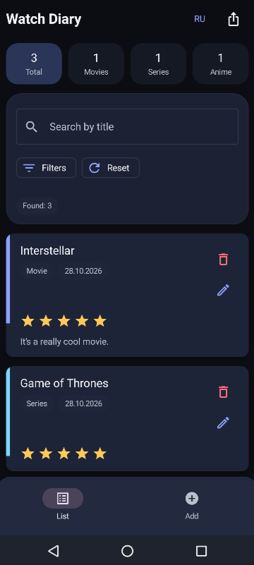
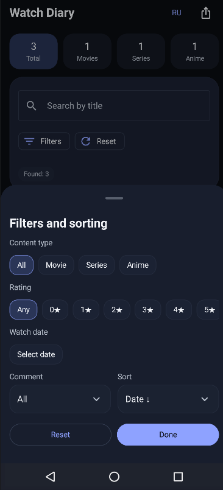
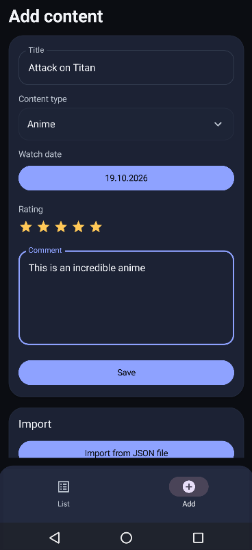
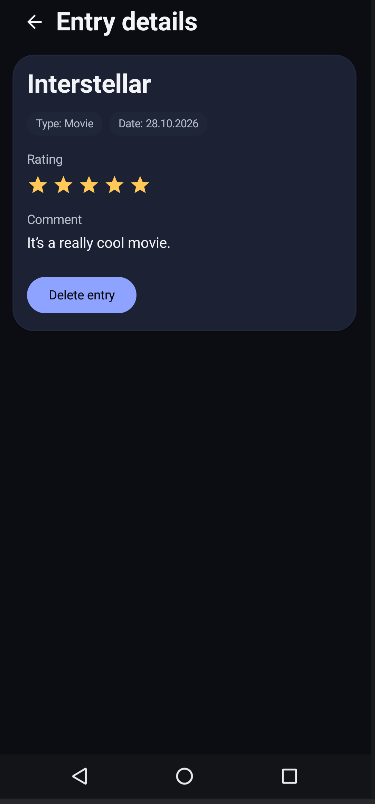

<div align="center">

# WatchDiary

### An offline Android diary for movies, TV series, and anime

**Watched Titles · Ratings · Notes · Search · JSON Backup**


*A native Android application built with Jetpack Compose, ViewModel, and Room.*

[Screenshots](#screenshots) · [Features](#features) · [Quick start](#quick-start) · [Architecture](#architecture) · [Testing](#automated-testing) · [Documentation](#documentation)

</div>

---

## Overview

**WatchDiary** is a native Android application for keeping a personal record of watched movies, TV series, and anime. Each entry includes a title, content type, watch date, rating, and comment.

The application is built with **Kotlin**, **Jetpack Compose**, and **Room**. It works offline and stores diary entries in a local SQLite database. Users can browse their diary, search and filter entries, and export or import data without creating an account.

## Screenshots

<table>
  <tr>
    <th>Diary</th>
    <th>Filters and sorting</th>
  </tr>
  <tr>
    <td></td>
    <td></td>
  </tr>
  <tr>
    <th>Add an entry</th>
    <th>Entry details</th>
  </tr>
  <tr>
    <td></td>
    <td></td>
  </tr>
</table>

## Features

| Area | Capabilities |
| --- | --- |
| **Diary entries** | Add, view, edit, and delete watched titles |
| **Ratings and notes** | Rate entries from 1 to 5 stars, or leave them unrated; add personal comments |
| **Search and filters** | Search by title; filter by content type, rating, watch date, and presence of a comment |
| **Sorting** | Sort by watch date, title, or rating |
| **Statistics** | View total and per-category entry counts; tap a counter to filter the list |
| **Deletion** | Confirm deletion; undo deletion from the list through a snackbar action |
| **JSON backup** | Export to Downloads or a selected file, share a backup, and import JSON files |
| **Text import** | Paste formatted entries and receive counts of imported, skipped, and invalid rows |
| **Duplicate detection** | Skip imported entries whose title and watch date already exist in the diary |
| **Localization** | Switch between Russian and English inside the app |

## Tech stack

| Layer | Technology |
| --- | --- |
| Language | Kotlin 1.9.22 |
| UI | Jetpack Compose, Material 3 |
| Navigation | Navigation Compose |
| Screen state | AndroidX ViewModel, StateFlow |
| Asynchronous operations | Kotlin Coroutines |
| Local persistence | Room 2.6.1, SQLite, KSP |
| JSON | Gson |
| File access | Android Storage Access Framework, MediaStore, FileProvider |
| Localization | Android string resources, AppCompat application locales |
| Unit testing | JUnit 4 |
| Build | Gradle Wrapper 8.13, Android Gradle Plugin 8.13.2, JDK 17 |

## Architecture

The project uses **MVVM with a repository** in a single Android app module.

```text
Compose screen
     │ user actions
     ▼
ViewModel → StateFlow<UiState> → Compose screen
     │
     ▼
DiaryRepository
     │
     ▼
DiaryEntryDao → Room → SQLite
```

Key implementation details:

- **Screen state:** each screen has a ViewModel and a UI state model; Compose observes state with lifecycle-aware collection.
- **Data access:** ViewModels access diary entries through `DiaryRepository`, which delegates persistence operations to a Room DAO.
- **Dependency setup:** `WatchDiaryApp` initializes the database and repository; a ViewModel factory supplies the repository to ViewModels.
- **Import:** text and JSON parsing run on a background dispatcher. The DAO imports entries in a transaction and checks for existing title/date pairs.
- **Export:** `ExportManager` reads entries through the repository, serializes them to JSON, and handles file output. The UI opens file pickers and the Android share sheet.

Read [Architecture](docs/ARCHITECTURE.md) for a walkthrough of the main files and data flow.

## Quick start

### Requirements

- Android Studio with support for the project's Android Gradle Plugin
- **JDK 17** configured as the Gradle JDK
- **Android SDK Platform 36**
- An Android device or emulator running **Android 7.0 (API 24) or later**
- Internet access for the initial Gradle and dependency downloads

### Run locally

1. Download or clone this repository and open its root folder in Android Studio.
2. Set the Gradle JDK to **JDK 17** and install SDK Platform 36 through SDK Manager if needed.
3. Let Gradle sync complete.
4. Select the **app** run configuration and launch it on a device or emulator.

Android Studio configures the local SDK path in `local.properties`. This machine-specific file is excluded from Git.

To build a debug APK from the repository root:

**Windows PowerShell:**

```powershell
.\gradlew.bat assembleDebug
```

**Linux / macOS:**

```bash
bash gradlew assembleDebug
```

The APK is generated at `app/build/outputs/apk/debug/app-debug.apk`.

## Import and export

JSON export produces an array containing `id`, `title`, `contentType`, `watchDate`, `rating`, and `comment` for each entry. On import, Room generates new IDs. Existing entries with the same title and watch date are skipped, regardless of content type.

JSON file import accepts files up to **2 MiB**. Invalid JSON entries cause the import to be rejected. Text import keeps valid rows and reports how many rows were invalid.

Text entries use one line per title:

```text
Title | MOVIE | 2026-10-28 | 5 | My comment
Another title | SERIES | 2026-10-27 | 0 |
```

Supported content types are `MOVIE`, `SERIES`, and `ANIME`. Dates use `YYYY-MM-DD`; ratings range from `0` (unrated) to `5`. The comment may be empty.

Exported JSON contains readable diary entries and comments. Users choose where to save or share these files.

## Automated testing

The repository includes **eight JUnit tests** in `ImportParserTest.kt`, covering:

- JSON import with regenerated local IDs
- Rejection of invalid ratings, unknown content types, and malformed JSON
- Text parsing with separators inside comments
- Invalid-row reporting and handling of empty lines

Run the local unit tests from Android Studio or the repository root:

**Windows PowerShell:**

```powershell
.\gradlew.bat testDebugUnitTest
```

**Linux / macOS:**

```bash
bash gradlew testDebugUnitTest
```

The existing automated tests cover the import parser. ViewModel behavior, Room operations, and screen interactions are not covered by this test suite.

## Repository structure

```text
WatchDiary/
├── app/
│   ├── src/main/
│   │   ├── java/com/example/watchdiary/
│   │   │   ├── MainActivity.kt       # Activity and navigation setup
│   │   │   ├── WatchDiaryApp.kt      # Database and repository setup
│   │   │   ├── data/
│   │   │   │   ├── export/           # JSON serialization and file output
│   │   │   │   ├── local/            # Room database, DAO, converters
│   │   │   │   ├── model/            # Entry model and enums
│   │   │   │   └── repository/       # Diary data access
│   │   │   ├── ui/
│   │   │   │   ├── components/       # Shared Compose components
│   │   │   │   ├── navigation/       # Screen routes
│   │   │   │   ├── screens/          # List, add, edit, and details
│   │   │   │   └── theme/            # Colors and typography
│   │   │   ├── util/                # Import parser, dates, UI messages
│   │   │   └── viewmodel/           # ViewModels and UI state models
│   │   └── res/                     # Resources and RU/EN translations
│   └── src/test/                    # Import parser unit tests
├── docs/
│   └── ARCHITECTURE.md
├── gradle/wrapper/
├── PRIVACY_POLICY.md
└── README.md
```

## Data and privacy

WatchDiary has no user accounts, backend, advertising SDK, or analytics SDK. The app does not request internet permission. Diary entries are stored in the app's private database.

Android system backup and device transfer are enabled for the database and preferences. These mechanisms depend on the device's settings and backup provider. Separately exported files remain wherever the user saves or sends them.

See [Privacy Policy](PRIVACY_POLICY.md) for details.

## Documentation

- [Architecture and code walkthrough](docs/ARCHITECTURE.md)
- [Privacy Policy](PRIVACY_POLICY.md)
- [Import parser tests](app/src/test/java/com/example/watchdiary/ImportParserTest.kt)

---

<div align="center">

**WatchDiary** · Android development portfolio project

*Built to explore Compose, local persistence, and everyday diary workflows.*

</div>
